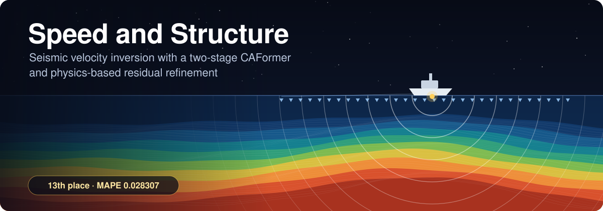
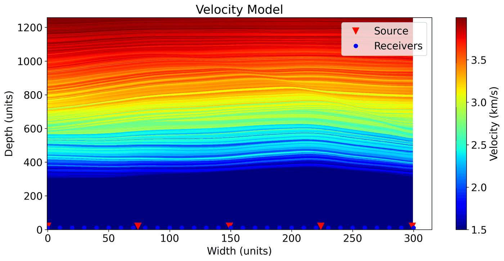
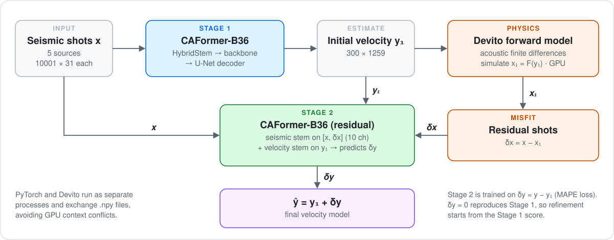
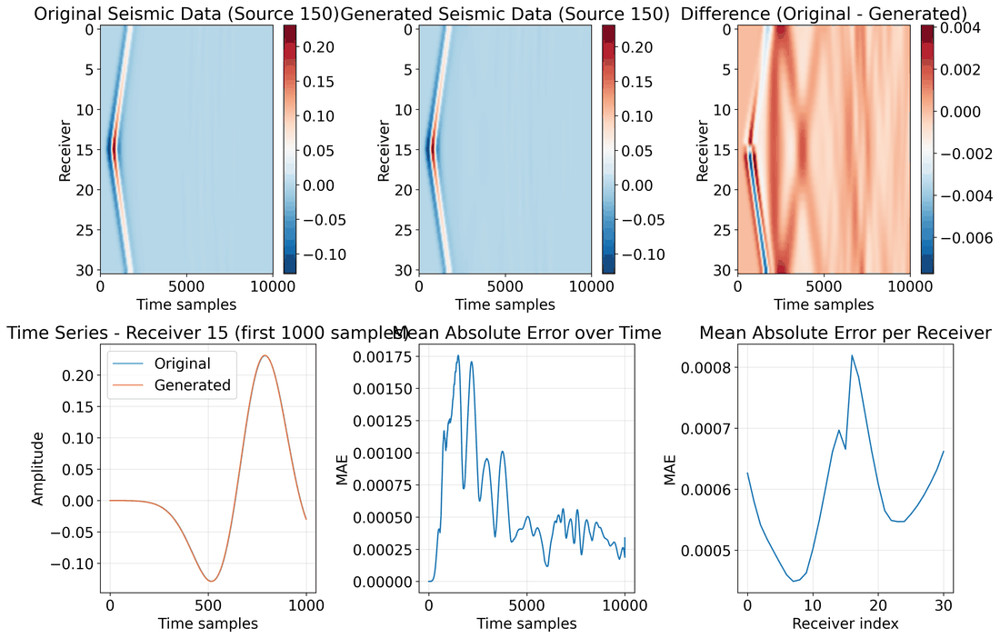

<p align="center">
  
</p>

<p align="center">
  <a href="https://thinkonward.com/app/c/challenges/speed-and-structure"></a>
  
  
  <br>
  
  
  
  
  <a href="LICENSE"></a>
</p>

<p align="center">
  <a href="#-the-challenge">Challenge</a> •
  <a href="#-approach">Approach</a> •
  <a href="#-forward-model-check">Forward model</a> •
  <a href="#-getting-started">Getting started</a> •
  <a href="#-acknowledgements">Acknowledgements</a>
</p>

---

My solution to the [ThinkOnward **Speed and Structure**](https://thinkonward.com/app/c/challenges/speed-and-structure) challenge. It placed **13th of 386 teams** on the predictive leaderboard, with a **MAPE of 0.028307**.

A CAFormer network makes a first estimate of the subsurface velocity. A wave-equation simulator then shows where that estimate disagrees with the recorded seismic data, and a second CAFormer uses that disagreement to correct the estimate.

## 🌊 The challenge

Seismic surveys send sound into the ground and record the echoes. **Velocity inversion** works backwards from those recordings to a map of how fast sound travels at each point underground, which reveals the geological structure.

| | |
|---|---|
| **Input** | 5 shot records (sources at `1, 75, 150, 225, 300`), each `10001 × 31`: 10,001 time steps × 31 receivers |
| **Output** | A 2D P-wave velocity model, `300 × 1259` (horizontal × depth), in km/s |
| **Metric** | Mean absolute percentage error (**MAPE**), averaged over the test samples |
| **Data** | 2,000 synthetic training samples, 150 test samples |
| **Result** | **13th of 386 teams** on the predictive leaderboard, **MAPE 0.028307** |

<p align="center">
  
  <br>
  <sub><i>A training velocity model, with the 5 source positions (▼) and 31 receivers (●) at the surface. Velocity increases with depth through gently folded layers.</i></sub>
</p>

## 🧠 Approach

<p align="center">
  <picture>
    <source media="(prefers-color-scheme: dark)" srcset="assets/pipeline-dark.svg">
    
  </picture>
</p>

### Stage 1: direct inversion
<sub>`src/sns_caformer_enhanced_notebook.py`</sub>

| Component | Details |
|---|---|
| **Stem** | `HybridStem` turns the 5 × `(10001, 31)` shot gathers into a near-square `(125, 124)` feature map |
| **Backbone** | `timm` **CAFormer-B36** (`caformer_b36.sail_in22k_ft_in1k`), ImageNet-pretrained |
| **Decoder** | U-Net style, with PixelShuffle upsampling, SCSE attention and intermediate convolutions, back to `300 × 1259` |
| **Multi-task** | An auxiliary head reconstructs the input seismic data |
| **Loss** | MAPE + total variation + local smoothness + gradient realism, with physics weights warmed up adaptively |
| **Training** | EMA of the weights, constant-then-cosine LR schedule, test-time augmentation |

### Physics: forward modelling
<sub>`src/sns_forward_devito_gpu.py` · `src/sns_forward_devito.py` · `src/sns_forward.py`</sub>

- A finite-difference acoustic simulator built with [Devito](https://www.devitoproject.org/), matched to the challenge's acquisition geometry: 5 sources, 31 receivers, 10,001 steps.
- The **GPU** version uses Devito's OpenACC backend (NVIDIA `nvc++`), with an OpenMP **CPU** version as a fallback.
- An alternative standalone **CuPy** simulator with custom CUDA kernels is also included.

### Stage 2: residual refinement
<sub>`src/sns_caformer_stage2.py`</sub>

- **Inputs:** the 10-channel stack `[x, δx]`, where `δx = x − F(y₁)`, and the Stage 1 velocity `y₁`.
- **Fusion:** each input has its own stem. The stem outputs are **summed** and passed to a CAFormer-B36 backbone.
- **Target:** the residual `δy = y − y₁`. Predicting `δy = 0` reproduces Stage 1 exactly, so refinement *starts* from the Stage 1 score.

> [!NOTE]
> PyTorch and Devito both want the GPU, and running them in one process caused conflicts. The pipeline is therefore split into separate **PyTorch-only** and **Devito-only** scripts that pass `.npy` files between them.

## 🔬 Forward model check

Before using the simulator in the pipeline, I checked it against the shot records provided with the challenge. For the velocity model above, the simulated shot from source 150 matches the original almost exactly. The largest point-wise difference is under 3% of the peak amplitude.

<p align="center">
  
  <br>
  <sub><i>Top: original shot, simulated shot and their difference. Bottom: one receiver's trace, and the mean absolute error over time and per receiver.</i></sub>
</p>

## 🚀 Getting started

### Setup

Python ≥ 3.12 and an NVIDIA GPU are assumed.

```bash
pip install -r requirements.txt
```

To run Devito on the GPU you also need the NVIDIA HPC SDK (`nvc++`). Without it, the scripts fall back to the CPU version, which is much slower.

### Data

Download the train and test sets from the challenge's data tab (the data isn't redistributed here) and arrange them like this:

```
data/
├── train/<sample_id>/receiver_data_src_{1,75,150,225,300}.npy, vp_model.npy
└── test/<sample_id>/receiver_data_src_{1,75,150,225,300}.npy
```

Paths are resolved relative to the repository root by default. Set `SNS_ROOT` to use a different location. Checkpoints are written to `models/`.

### Training

Run everything from the repository root.

```bash
python src/sns_caformer_enhanced_notebook.py --train   # 1. Stage 1           → models/caformer_sns_*.pth
python src/create_stage2_subset.py                     # 2. data/train        → data/train_stage2
python src/generate_stage1_predictions.py              # 3. y₁ for every training sample   (PyTorch)
python src/preprocess_stage2_data_devito.py            # 4. δx and δy via the simulator    (Devito)
python src/sns_caformer_stage2.py --train              # 5. Stage 2           → models/caformer_sns_stage2_*.pth
```

### Inference

```bash
# 1. Stage 1 predictions (PyTorch)
python src/stage1_inference.py --test_data_dir data/test \
    --stage1_model models/caformer_sns_best_ema.pth --predictions_dir stage1_test_predictions

# 2. Forward-model the predictions and compute δx (Devito)
python src/devito_forward_inference.py --test_data_dir data/test \
    --stage1_predictions_dir stage1_test_predictions --output_dir test_data_processed

# 3. Stage 2 refinement → submission (PyTorch)
python src/stage2_inference.py --processed_data_dir test_data_processed \
    --stage2_model models/caformer_sns_stage2_best.pth --submission_file submission.npz
```

<details>
<summary><b>📁 Repository layout</b></summary>

```
src/
├── sns_caformer_enhanced_notebook.py  # Stage 1 model + training/inference (final)
├── sns_caformer_notebook.py           # Stage 1 baseline (earlier, simpler version)
├── sns_caformer_stage2.py             # Stage 2 residual model + training
├── stage2_dataset_preprocessed.py     # Dataset for preprocessed Stage 2 training data
├── create_stage2_subset.py            # Copy (a subset of) train/ → train_stage2/
├── generate_stage1_predictions.py     # [train] Stage 1 predictions y₁        (PyTorch)
├── preprocess_stage2_data_devito.py   # [train] x₁ = F(y₁), δx, δy            (Devito)
├── stage1_inference.py                # [test]  Stage 1 predictions y₁        (PyTorch)
├── devito_forward_inference.py        # [test]  x₁ = F(y₁), δx               (Devito)
├── stage2_inference.py                # [test]  y₁ + δy → submission .npz    (PyTorch)
├── sns_forward_devito_gpu.py          # Devito forward model, OpenACC/GPU
├── sns_forward_devito.py              # Devito forward model, OpenMP/CPU
├── sns_forward.py                     # CuPy/CUDA-kernel forward model
└── sns_forward_verification.py        # Forward-model sanity checks & plots
assets/                                # README figures
```

</details>

## 🙏 Acknowledgements

- The two-stage "predict → simulate → refine the residual" design follows **Jun Koda's** [15th-place two-stage model](https://www.kaggle.com/competitions/waveform-inversion/writeups/jun-koda-15th-place-two-stage-model) from the Kaggle [Yale/UNC-CH Geophysical Waveform Inversion](https://www.kaggle.com/competitions/waveform-inversion) competition.
- The CAFormer encoder-decoder builds on **Brendan Artley's** [CAFormer baseline](https://www.kaggle.com/competitions/waveform-inversion/discussion/582785) from the same competition.
- [Devito](https://www.devitoproject.org/) for finite-difference wave propagation.
- [`timm`](https://github.com/huggingface/pytorch-image-models) for the CAFormer backbone ([MetaFormer Baselines for Vision](https://arxiv.org/abs/2210.13452), Yu et al.).
- ThinkOnward for hosting the challenge.

## 📄 License

[MIT](LICENSE). The challenge data is covered by ThinkOnward's terms and isn't included here.
